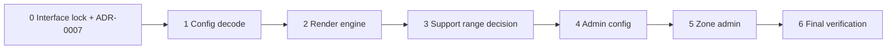

# Architecture improvement plan — round 2

Status: approved, not yet implemented.  
Source review: `/tmp/architecture-review-20261125T210424.html` (5 candidates).  
Interface lock: this document, after Design It Twice across all five candidates.  
Language: [`CONTEXT.md`](../CONTEXT.md) for domain terms; module, interface,
implementation, depth, seam, adapter, leverage and locality for architecture.

ADR-0001 through ADR-0006 stay accepted. ADR-0007 is written at
[`docs/adr/0007-zone-driven-base-name-response.md`](adr/0007-zone-driven-base-name-response.md).
No phase re-litigates file election, wire encoding, Mount adapters, Zone spellings,
support range or CI self-containment.

## Guiding rules

1. **Deepen, do not reshuffle.** Move behaviour behind one small interface; do
   not create a module whose interface is as wide as its implementation.
2. **The interface is the test surface.** Callers and tests cross the same seam.
   Delete tests on shallow modules once the deeper interface has tests.
3. **Two adapters justify a seam.** Real/fake request and real/fake occ adapters
   justify their seams. Pure in-process config decoding gets no adapter.
4. **ADRs are locked.** A phase may add a field declared by ADR-0007; it may not
   reopen an accepted ADR without a new ADR.
5. **Keep CI self-contained.** Everything `.github/workflows/e2e.yml` needs
   stays inside `apps/files_readmemd/` (ADR-0006).
6. **One commit per phase, gated.** Do not start the next phase until tests,
   lint, build and browser profiles are green.
7. **Commit identity.** Author and committer:
   `Dennis Vestergaard Værum <github@varum.dk>`; no `Co-Authored-By` footer.

## Candidate → phase map

| Review candidate | Strength | Dependency category | Phase |
| --- | --- | --- | --- |
| Frontend config decoding | Worth exploring | in-process | 1 |
| Render engine module | Strong | local-substitutable | 2 |
| Support range decision | Strong | mock | 3 |
| Admin config module | Strong | local-substitutable | 4 |
| Zone-driven admin rendering | Worth exploring | local-substitutable | 5 |
| Final verification | — | — | 6 |

## Sequencing



Config decode goes first because it is pure and gives every later suite
normalized fixtures. Render engine goes next because it has the highest depth
gain. Support range is isolated in CI; admin config and Zone admin follow once
their request and declaration seams are understood.

---

## Phase 0 — Interface lock and ADR-0007

### Current shape

Five Design It Twice comparisons are complete. ADR-0007 is written but not yet
committed. No implementation files have changed in this round.

### Locked interfaces

```text
decodeConfig(wireMap) -> frozen NormalizedConfig
  { engines, baseNames, flags }

RenderEngine module
  props: election, content, mount
  no theme, plugin, path or engine props

Support range decision executable
  enable --app <id> --info <path> --occ <command>
  expectation --info <path> --version <tag>

bindAdminConfig(root, { request? }) -> void
  request({ method, url, params? }) -> Promise

Zone admin module
  constructed with snapshot and renderer adapters
  render() -> string
  baseNameResponse(adminToken) -> ?string
```

### Steps

1. Keep ADR-0007 at `docs/adr/0007-zone-driven-base-name-response.md`.
2. Keep this document as the record of the locked interfaces. A later change to
   a locked interface needs a new ADR only if it is hard to reverse or surprising.
3. Commit ADR-0007 and this plan with the required identity. Change no source.

### Acceptance

- ADR-0007 and this plan are committed; no source file changes in this phase.
- No commit carries `Co-Authored-By`.

---

## Phase 1 — Deepen frontend config decoding

**Dependency category:** in-process.

### Current shape

`Readmemd.vue` loads the raw eight-key wire map; `fileElection.js` compares
`=== 'true'` and looks up config keys; `contentRefresh.js` passes the map
through. PHP `ConfigSnapshot` already owns typed decoding.

### Target shape

One pure module decodes the wire map, applies defaults and returns a frozen
`NormalizedConfig` consumed by the view, content refresh and File election.
The raw wire map appears only at the decode seam.

### Steps

1. Add `src/modules/configDecode.js` with `decodeConfig(wireMap)`.
2. Change `Readmemd.vue` to decode once and pass the normalized result to
   `createContentRefresh`.
3. Change `fileElection.js` to read `config.engines` and `config.baseNames`
   without wire strings or config-key lookups.
4. Convert `tests/js/fileElection.test.js` to normalized fixtures; add one
   decode/defaults test covering malformed and legacy values.
5. Leave ADR-0002 wire strings and PHP `ConfigSnapshot` untouched.

### Acceptance

- No `=== 'true'` or `configKey` lookup remains outside `configDecode.js`.
- Decode/defaults and normalized election tests are green.
- `npm test`, `npm run lint`, `npm run stylelint`, `npm run build` are green.

---

## Phase 2 — Deepen the Render engine module

**Dependency category:** local-substitutable.

### Current shape

`Readmemd.vue` branches on `election.engine` across three shallow engine
modules. Theme CSS, plugin preparation and async markup decisions leak into
`MarkdownEngine.vue` and `AsciidocEngine.vue`; `HtmlEngine.vue` is a pass-through.

### Target shape

One module with props `election`, `content` and `mount`. The three engine
implementations, theme CSS, plugin rules, converter construction, async markup,
checkbox disabling and footer CSS sit inside. The flexible engine registry
stays internal.

### Steps

1. Add `src/components/RenderEngine.vue` as the single external module.
2. Move dispatch, theme selection, plugin preparation and async markup into its
   implementation; keep `createMarkdownConverter` as an internal seam.
3. Reduce the three current engine modules to internal implementations; delete
   direct imports from `Readmemd.vue`.
4. Enforce invariants: latest async result wins; unknown engine renders an
   empty Zone and logs; plugin or CSS failure degrades to base markup; no throw
   reaches the caller.
5. Keep converter internal tests; add interface outcome tests for markup,
   clearing, filename and overlap across both Zones and both Mounts.

### Acceptance

- `Readmemd.vue` contains no engine branch, CSS import or plugin code.
- Converter internal tests and the new render suite are green.
- Visual CI baselines are unchanged.

---

## Phase 3 — Deepen the Support range decision

**Dependency category:** mock.

### Current shape

`ci/lib/support-range.sh` is tested as a pure parser. The boot hook and CI
runner call sites are checked only by grepping their source text, so a wrong
invocation escapes the test surface.

### Target shape

One executable decision with two explicit commands: `enable` for the boot hook
and `expectation` for the CI runner. Real occ and fake occ are adapters at the
`$OCC` seam.

### Steps

1. Add `enable --app <id> --info <path> --occ <command>`: read major from
   `occ status`, parse the Support range, enable only when allowed, print the
   skip reason otherwise.
2. Add `expectation --info <path> --version <tag>`: print `enabled` or
   `disabled` without calling occ; normalize `35-apache` to major 35.
3. Change `ci/hooks/before-starting/10-enable-files-readmemd.sh` to call
   `enable`; change `ci/run.sh` to call `expectation`.
4. Add a fake occ adapter that returns status JSON and records every
   `app:enable` call. Test enabled and skipped outcomes.
5. Delete source-text assertions at `ci/tests/shell/run.sh:76–88`; keep parser
   boundary tests at min, max, min−1 and max+1.

### Acceptance

- No shell test greps hook or runner source for `support-range.sh` or
  `support_allows`.
- ADR-0005 range and `BASE_SHA` negative control are unchanged.
- `./scripts/ci.sh all` is green; NC 35 still rejects the negative control.

---

## Phase 4 — Deepen the admin-config module

**Dependency category:** local-substitutable.

### Current shape

`src/config.js` contains two near-identical engine handlers; `adminFileList.js`
owns DOM delegation while `config.js` owns endpoint mapping. Add failures are
uncaught; remove failures are logged. Two shallow test suites cover fragments.

### Target shape

One `bindAdminConfig(root, { request? })` module owns DOM wiring, endpoint
mapping and request handling. The default request adapter wraps axios; tests
inject a local fake. DOM changes only after success; both failure modes log.

### Steps

1. Add `src/modules/adminConfig.js` with the locked interface.
2. Derive engine and Zone descriptors internally from the existing engine table
   and `zones.json`; keep ADR-0002 wire strings and ADR-0004 spellings.
3. Fold the DOM behaviour of `adminFileList.js` into the implementation; reduce
   `config.js` to one binding call.
4. Delete `tests/js/config.test.js` and `tests/js/adminFileList.test.js`; add
   one deep suite asserting request descriptors, endpoint strings, wire strings
   and DOM state on success and failure.
5. Keep request errors logged with the DOM unchanged.

### Acceptance

- `config.js` contains no handler bodies or endpoint strings.
- Both shallow suites are deleted; one deep suite is green.
- Visual CI baselines are unchanged.

---

## Phase 5 — Deepen Zone-driven admin rendering

**Dependency category:** local-substitutable.

### Current shape

`templates/Filelist.php` duplicates one block per Zone and disagrees on the
`<li>` id prefix. `ConfigController::addFileName()` branches on the literal
`footer`. ADR-0007 records the fix.

### Target shape

One module constructed with `ConfigSnapshot` and renderer adapters exposes
`render()` and `baseNameResponse(adminToken)`. The `responseSemantics` field in
`zones.json` drives the response rule; the four existing spellings stay.

### Steps

1. Add `responseSemantics` to both entries in `zones.json` and validate it in
   `lib/ZoneDefinition.php` like the existing four fields.
2. Add `lib/View/ZoneAdminView.php` with the locked interface.
3. Replace the duplicated template blocks with one loop that calls `render()`.
4. Replace the literal footer branch in `ConfigController` with
   `baseNameResponse($zone)`.
5. Add a deep PHP suite using a fake renderer and a `ConfigSnapshot` fixture;
   assert Zone order, escaping and response per Zone.

### Acceptance

- `ConfigController` contains no literal `footer` token.
- `Filelist.php` contains no duplicated per-Zone block.
- ADR-0004 spellings and ConfigSnapshot defaults are unchanged.

---

## Phase 6 — Final verification and rollout

### Steps

1. Run Vitest, PHPUnit, `npm run lint`, `npm run stylelint`, `npm run build`,
   `scripts/dev.sh verify` and `scripts/ci.sh all`.
2. Confirm browser profiles and baselines: full, compat 29/33/34/35 and
   negative control on NC 35.
3. Confirm every phase commit uses the required author and committer and has no
   `Co-Authored-By` footer.
4. Push `master` only to `https://github.com/dvaerum/files_readmemd`; verify the
   remote head and the GitHub Actions Firefox visual CI run.
5. Never push to upstream `mamatt/files_readmemd`.

### Acceptance

- All local gates green.
- GitHub Actions visual CI green with `playwright-report` artifact.
- Remote head matches the final local commit.
