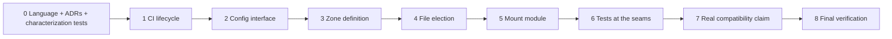

# Architecture improvement plan — files_readmemd

Status: proposed, not yet implemented.  
Source review: `/tmp/architecture-review-20261124T184905Z.html` (7 candidates).  
Language: [`CONTEXT.md`](../CONTEXT.md) for domain terms; module, interface,
implementation, depth, seam, adapter, leverage and locality for architecture.

No ADRs existed when the review was made. Each phase below names the decision
record to write **before** changing code, so a future review does not
re-litigate the load-bearing behavior it depends on.

## Guiding rules

1. **Deepen, do not reshuffle.** Move behaviour behind one small interface;
   do not create a new module whose interface is as wide as its implementation.
2. **The interface is the test surface.** Tests cross the same seam callers
   cross. Delete tests on shallow modules once tests at the deeper interface
   exist.
3. **Two adapters justify a seam.** Private/public mounts are a real seam.
   A single in-process helper is not.
4. **Design it twice before fixing an interface.** For each deepened module,
   sketch two or three interfaces, compare depth and seam placement, record
   the winner in an ADR, then implement.
5. **Preserve fork portability.** Everything needed by
   `.github/workflows/e2e.yml` stays inside this checkout; no root-workspace
   file becomes a CI dependency.
6. **One commit per phase, gated.** Do not start the next phase until the
   phase's tests, lint, build and browser profiles are green.

## Candidate → phase map

| Review candidate | Strength | Phase |
| --- | --- | --- |
| Make the CI lifecycle explicit | Strong | 1 |
| Give config one typed interface and one snapshot | Strong | 2 |
| Define zones once | Worth exploring | 3 |
| Deepen file election | Strong | 4 |
| Unify the two mount adapters | Worth exploring | 5 |
| Replace source-text regression tests with caller-level behavior tests | Worth exploring | 0 and 6 |
| Fix or remove the tautological negative control | Strong | 7 |

## Dependency categories used

| Category | Meaning here | Candidates |
| --- | --- | --- |
| in-process | Pure computation; no I/O; merge and test directly | File election, zone definition |
| local-substitutable | A local stand-in exists; keep the seam internal to the implementation | Config module |
| ports & adapters | Two adapters are justified: private Files and public share | Mount module |
| mock | External or container-owned dependency; inject a fake | CI lifecycle, negative control |

## Sequencing



Phase 1 comes first because every later phase is verified through the harness.
Phases 2–5 move in dependency order: the file election cannot be deepened
until config and zones have stable interfaces, and the mount module cannot drop
its mode flag until file election no longer reads globals through the view.

---

## Phase 0 — Language, decision records and characterization tests

**Candidate:** test-seams (start), all load-bearing decisions.

### Current shape

`CONTEXT.md` did not exist; the review had to infer domain terms from code and
CI selectors. `tests/js/regressions.test.js` asserts source text, so renames
break tests without a behavior change. `tests/bootstrap.php` hardcodes
`/var/www/html` and `/var/www/html/custom_apps/files_readmemd`.

### Target shape

One domain glossary and one set of behavior tests that describe what the app
does today, before any implementation changes.

### Steps

1. Keep the new `CONTEXT.md` as the single home for domain terms. Do not add
   general programming terms to it.
2. Add ADR stubs under `docs/adr/` for the decisions that later phases must
   not change accidentally:
   - ADR-0001: hidden README content files and later base names win file
     election.
   - ADR-0002: config values stay the strings `"true"` / `"false"` on the
     wire while the PHP module exposes typed queries internally.
   - ADR-0003: private Files uses header registration; public shares poll for
     file-list readiness.
   - ADR-0004: zone vocabulary is `header`/`footer` for people, `headermd`/
     `footermd` for DOM, and `fileslist_*` for stored config.
   - ADR-0005: support range and the meaning of the negative control. Decide
     this in Phase 7; create the stub now.
   - ADR-0006: `ci/` keeps its own fixture and hook copies so a standalone
     fork checkout works.
3. Add characterization tests that assert observable behavior, not source
   text:
   - `engineType('README.md', configSnapshot)` returns `markdown`.
   - `fileNamesForZone(...)` includes `.README.md` before it includes
     `README.md` in the ordered candidate list, with the hidden variant later.
   - `ConfigController::getConfig()` returns the current eight-key wire map.
   - `ConfigController::addFileName()` / `removeFileName()` preserve order.
4. Make `tests/bootstrap.php` resolve paths from `NEXTCLOUD_ROOT` and
   `APP_ROOT`, with the current container paths as defaults.
5. Run `npm test`, PHPUnit, `npm run lint`, `npm run stylelint`,
   `npm run build` and `./scripts/ci.sh all` before leaving this phase.

### Acceptance

- No test reads `src/**` as text.
- PHPUnit passes outside `/var/www/html` when both environment variables are
  set to local checkout paths.
- Every load-bearing behavior above has an ADR stub or a characterization
  test.

---

## Phase 1 — Make the CI lifecycle explicit

**Candidate:** CI lifecycle. **Dependency category:** mock.

### Current shape

`ci/run.sh` owns lifecycle state in shell globals: `STACK_STARTED`, `PROJECT`,
`HOST_PORT`, `WORKTREE_DIR`, `CLEANED`. Documented behavior and actual behavior
disagree:

- `KEEP_STACK=1` is neutralized by explicit `stop_stack()` calls in
  `full_profile`, `compat_profile` and `negative_profile`.
- `down` calls `stop_stack()`, which is a no-op when `STACK_STARTED=0` at
  process start.
- `UPDATE_SNAPSHOTS` is exported to Compose but unused; the real switch is
  `UPDATE_BASELINES` in `run_pw()`.
- `all` calls `full_profile`, `compat_profile`, `negative_profile` but not
  `setup()`, despite its help text saying `all`.
- `ensure_setup()` checks for any `js/files_readmemd-*.js`, so stale assets
  pass after source changes.

### Target shape

A thin `ci/run.sh` dispatcher over three modules with narrow interfaces:

```text
ci/lib/config.sh      -> ci_config <profile>  (prints shell-safe KEY=VALUE lines)
ci/lib/lifecycle.sh  -> stack_up / stack_down / stack_status / cleanup
ci/lib/setup.sh      -> ensure_assets (hash-based) / ensure_playwright
```

`ci_config` is the one seam for profile configuration. It returns project,
port, Nextcloud version and image, admin credentials, share token, state list,
`KEEP_STACK`, `UPDATE_BASELINES`, `BASE_SHA` and a build stamp. Shell functions
take those values as named parameters; they do not read globals orAmbient
environment except to build the config once.

### Steps

1. Move the environment defaults from the top of `run.sh` into `ci_config`.
2. Make `stack_down` query `docker compose ps` so `down` works in a fresh
   process; keep `STACK_STARTED` only for log-on-failure behavior.
3. Make `cleanup` honor `KEEP_STACK` instead of the individual profiles.
4. Replace the `UPDATE_SNAPSHOTS` Compose variable with `UPDATE_BASELINES`
   passed explicitly to `run_pw`; remove the unused variable.
5. Call `setup()` from `all`, or change the help text and document why setup
   is intentionally external. Choose one and record it.
6. Compute a build stamp from `src/**`, `package.json`, `package-lock.json`
   and `webpack.js`; rebuild only when the stamp differs.
7. Add shell-level tests for `ci_config` and `stack_status`. A small
   `ci/tests/shell/run.sh` can stub `docker compose` with a fake executable
   and assert the printed config; no real container needed.
8. Keep all screenshot behavior unchanged: no baseline updates in this phase.

### Acceptance

- `KEEP_STACK=1 ./scripts/ci.sh negative` leaves the stack up; `./scripts/ci.sh
  down` then removes it.
- `./scripts/ci.sh down` works in a fresh shell with no prior run.
- `UPDATE_BASELINES=1` is the only switch that updates PNGs.
- `./scripts/ci.sh all` runs setup and all profiles, with all 11 browser tests
  green and no baseline diff.

---

## Phase 2 — Give config one typed interface and one snapshot

**Candidate:** config typed interface. **Dependency category:** local-substitutable.

### Current shape

`lib/Services/Config.php` exposes `getAppValue()` / `setAppValue()` as its
interface. `getAllAppValue()` returns four keys; `ConfigController::getConfig()`
returns eight. Templates compare raw strings to `"true"`; `src/config.js`
compares strings; `ci/run.sh` sets strings because `occ --type=boolean` stores
`"1"`, which breaks those comparisons.

### Target shape

One config module owns defaults, encoding and decoding. It exposes named
queries to callers and one normalized snapshot to the endpoint and initial
state. The wire map stays string-valued during migration so the browser
harness and existing browser assets keep working.

Interface settled by the Design It Twice gate:

- **Zone parameter:** a `Zone` value object now would duplicate the vocabulary
  that ADR-0004 assigns to Phase 3. Use the existing admin tokens `header` /
  `footer` at this seam; Phase 3 replaces the token with the single zone
  declaration without changing callers.
- **Snapshot shape:** a typed, immutable `ConfigSnapshot` built from the raw
  app values, not a thin wrapper over the raw map. It owns defaults, boolean
  parsing and JSON list decoding; `Config` owns storage and named queries. The
  endpoint and initial state both emit `toWireArray()`.

```php
final class ConfigSnapshot {
  public function isEngineEnabled(string $engine): bool;
  public function baseNamesForZone(string $zone): array; // list<string>
  public function toWireArray(): array; // eight legacy string/list keys
}

class Config {
  public function snapshot(): ConfigSnapshot;
  public function isEngineEnabled(string $engine): bool;
  public function zoneBaseNames(string $zone): array;
  public function setEngineEnabled(string $engine, bool $enabled): void;
  public function setFlag(string $key, bool $enabled): void;
  public function setZoneBaseNames(string $zone, array $names): void;
  public function addZoneBaseName(string $zone, string $name): void;
  public function removeZoneBaseName(string $zone, string $name): void;
}
```

### Steps

1. Add `ConfigSnapshot` and named queries beside the current raw getters; do
   not delete the getters yet.
2. Move default initialization into the snapshot constructor so defaults have
   one home.
3. Change `ConfigController::getConfig()` to return
   `$config->snapshot()->toWireArray()`.
4. Change `lib/Settings/Admin/Engine::getForm()` and `templates/Engine.php` to
   read `isEngineEnabled('asciidoc')` / `isEngineEnabled('html')`, removing the
   string comparison from the template.
5. Change `ConfigController::addFileName()` and `removeFileName()` to call
   the zone-named methods; keep their current route behavior.
6. Add PHPUnit tests for: defaults, malformed JSON fallback, boolean parsing,
   ordered add/remove, and snapshot wire compatibility.
7. Once no caller remains, remove `getAppValue()` / `setAppValue()` from the
   module's interface, keeping them as private implementation details only if
   still needed.
8. Keep `ci/run.sh` setting the same wire strings until Phase 4 switches the
   frontend to typed config.

### Acceptance

- Two snapshot producers become one.
- No template or controller compares a raw config string.
- `ConfigControllerTest` asserts typed behavior plus one wire-compatibility
  test; no test asserts a source literal.
- Full and compat browser profiles pass with unchanged baselines.

---

## Phase 3 — Define zones once

**Candidate:** zone definition. **Dependency category:** in-process.

### Current shape

Zone identity crosses seams as four vocabularies: `header`/`footer` in admin
actions, `headermd`/`footermd` in DOM classes and view props,
`fileslist_header`/`fileslist_footer` in stored config, and CSS selectors in
CI. `fileNamesForZone()` currently treats every value except `footermd` as a
header, so a third zone would silently become a header.

### Target shape

One declaration, `zones.json`, consumed by PHP, webpack and CI:

```json
{
  "headermd": {
    "adminToken": "header",
    "configKey": "fileslist_header",
    "domClass": "headermd",
    "endpointSegment": "header"
  },
  "footermd": {
    "adminToken": "footer",
    "configKey": "fileslist_footer",
    "domClass": "footermd",
    "endpointSegment": "footer"
  }
}
```

`lib/ZoneDefinition.php` reads it for PHP templates and the controller;
`src/config.js` imports it for admin actions; `ci/tests/zones.js` imports the
same file for selectors. Exhaustive mapping replaces the binary fallback.

Interface settled by the Design It Twice gate:

- **Declaration shape:** the four fields above are the whole declaration. The
  object key (`headermd` / `footermd`) is the canonical zone id. Default base
  names stay in `ConfigSnapshot` because they are configuration values, not
  vocabulary; adding a zone still needs its default added there.
- **One config seam:** Phase 2's callers keep passing admin tokens. PHP's
  `ZoneDefinition` and JS's `zones.js` both expose `zone(id)`, `ids()` and
  reverse lookups for each field, and both fail loudly on an unknown id or a
  duplicated field value. `ConfigSnapshot` builds its zone-to-config-key map
  and the wire map's zone entries from `ZoneDefinition`.
- **One rendering seam:** `main.js`, `public.js` and `Readmemd.vue` ask for a
  zone by canonical id and read its `domClass`; they never compare against a
  literal `headermd` / `footermd`. Nextcloud's own `.filelist-header` and
  `.filelist-footer` mount points stay literal because they are core selectors,
  not app vocabulary.
- **One CI seam:** `ci/tests/zones.js` derives both `data-zone` link selectors
  (admin token) and zone element selectors (`domClass`) from the declaration.
  Baselines stay byte-identical.

### Steps

1. Create `zones.json` and the PHP loader with validation: every zone must
   define all four fields; unknown zone ids fail loudly.
2. Replace hard-coded `fileslist_header` / `fileslist_footer` in
   `ConfigController`, `templates/Filelist.php`, `src/config.js` and
   `Readmemd.vue` with lookups through the definition.
3. Replace the `zone === 'footermd' ? footer : header` fallback with an
   exhaustive lookup and an explicit error.
4. Generate CI selectors from `zones.json` instead of repeating
   `.headermd` / `.footermd` in `tests/full.spec.js`.
5. Add Vitest tests for the map and PHPUnit tests for the loader, including
   the unknown-zone failure.
6. Keep DOM classes and stored config keys unchanged; no visual baseline
   changes.

### Acceptance

- Adding a zone requires one edit to `zones.json` plus the rendering code, not
  a search across four vocabularies.
- No `if (zone === 'footermd')` or equivalent remains.
- Full browser matrix passes unchanged.

---

## Phase 4 — Deepen file election

**Candidate:** file election. **Dependency category:** in-process. **Top
recommendation.**

### Current shape

`src/utils/fileSelection.js` exports `engineType(fileName, config)` and
`fileNamesForZone(zone, config)`. `Readmemd.vue` still owns the real election:
`getElectedFileName()` loops over candidates and directory names and lets the
last match win. The helper's interface exposes config, zone tokens and
extension tables, so its depth is shallow; deleting it would return that code
to its one caller. Hidden-file-wins and later-base-name-wins are real behavior
encoded accidentally in loop order.

### Target shape

One deep module that takes a directory's file names and returns the complete
answer for a zone.

Illustrative interface, to be settled by the Design It Twice gate:

```js
electForZone({
  zone,                  // Zone id, e.g. 'headermd'
  config: ConfigSnapshot,
  directoryNames: string[],
}) -> { fileName, engine, baseName, hidden, reason } | null
```

The implementation hides the extension table, candidate generation, engine
gating, priority order and tie-break. `engineType` and `fileNamesForZone`
remain internal seams for the module's own tests, not part of its interface.

Interface settled by the Design It Twice gate:

- **Zone input:** `zone` is the canonical id from `zones.json`. The view derives
  it from its DOM-class prop with `zoneForDomClass()`, so mount code keeps using
  the declaration's `domClass` without knowing the election vocabulary.
- **Directory input:** `directoryNames` are file names only; the adapters have
  already dropped folders. The module never sees file objects or paths.
- **Priority:** build every enabled candidate, then sort by the descending
  tuple `(baseIndex, engineRank, hidden, extensionIndex)` and take the first
  name present. `engineRank` is `html > asciidoc > markdown`; `hidden` is
  `true > false`; the later extension in the table wins. This makes the old
  "last match wins" loop order explicit and preserves every current winner.
- **Result:** `reason` is a stable, human-readable explanation of the winning
  variant, e.g. `hidden markdown variant of base 'README'`. It is for logs and
  tests, never rendered to users.
- **Boundary:** `src/modules/fileElection.js` is the only election module.
  `src/utils/fileSelection.js` is deleted once its tests are replaced.

### Steps

1. Write tests at the new interface before moving code:
   - root folder with both `HEADER.md` and `.HEADER.md`: hidden wins;
   - subfolder with only `README.md`: visible wins;
   - two configured base names where the later base has both variants: later
     base wins;
   - AsciiDoc/HTML disabled: their candidates are never elected;
   - empty directory: returns `null`.
2. Add `src/modules/fileElection.js` with the interface above. Move the
   extension table, candidate generation and engine gating into its
   implementation.
3. Make ordering explicit: a documented `priority` list plus a documented
   tie-break. Do not rely on overwrite-by-loop.
4. Change `Readmemd.vue` to call `electForZone()` with the directory names it
   already obtains from its file-list adapter. Remove `engineType`,
   `fileNamesForZone` and `getElectedFileName()` from the view.
5. Update `tests/js/fileSelection.test.js` to call the new interface only.
   Delete tests that still import the old shallow exports once coverage is
   replaced.
6. Update `ci/tests/full.spec.js` to keep asserting the same rendered DOM;
   no baseline updates.
7. Record ADR-0001 with the exact tie-break and the CI fixtures that depend
   on it.

### Acceptance

- One module owns file election; the view owns only rendering.
- No caller knows the extension table or the order in which variants are
  generated.
- Deleting the module would reintroduce the policy across every mount, so the
  deletion test says it earns its place.
- Full browser matrix passes unchanged.

---

## Phase 5 — Unify the two mount adapters

**Candidate:** mount adapters. **Dependency category:** ports & adapters.

### Current shape

`src/main.js` registers a Files `Header` and mounts two `ReadmemdView`
instances; `src/public.js` polls `OCA.Sharing.PublicApp.fileList.files` and
mounts the same view into public-share containers. `Readmemd.vue` detects mode
from `#isPublic`, reads `#sharingToken`, and chooses download URL shapes. Two
adapters are justified; the seam is real, but it currently leaks into the view.

### Target shape

One mount module with a file-list adapter at the seam:

```js
createMount({
  zone,
  fileListAdapter,  // getContents(path), currentPath(), downloadUrl(fileName)
  path,
  onPathChange,
}) -> { update(path), destroy() }
```

Adapter A: private Files `Header` view. Adapter B: public-share file list.
Both satisfy the same interface; tests inject a fake third adapter. The mount
module owns node creation, node placement, polling only where the public
adapter requires it, and path synchronization.

Interface settled by the Design It Twice gate:

- **Adapter surface:** `whenReady()`, `currentPath()`, `directoryNames(path)`,
  `downloadUrl(fileName, path)`, `linkUrl(link, path)`, `footerContainer()`, a
  `mode` string, `mountPoint(zoneDefinition)` and `onPathChange(callback)`
  returning an unsubscribe function. `directoryNames` replaces the view's old
  `getContents()` loop; `linkUrl` and `footerContainer` keep Markdown link
  rewriting and footer layout inside adapters, so no view or engine component
  reads share tokens, router URLs or `#isPublic`. The private adapter polls
  nothing; the public adapter owns readiness and path-change intervals.
- **Mount surface:** `createMount()` returns `{ update(path), destroy() }`.
  Node creation is the mount module's job: an adapter's `mountPoint()` supplies
  a parent, `append`/`after` position and an optional existing node; the mount
  module reuses or creates the node and always keeps the Vue root as its node.
- **View boundary:** `Readmemd.vue` receives `fileListAdapter` and a `path`. It
  never reads `#isPublic`, `#sharingToken`, `OCA`, `OC` or Nextcloud URLs, and
  never branches on mode. It asks the adapter for names and a download URL,
  passes the adapter to engine components for link/theme decisions, and renders
  the election result.
- **Registration:** `main.js` creates one private adapter per render (the
  header slot differs per render) and calls `update()` from `Header.updated`;
  `public.js` creates one public adapter, awaits readiness, then creates both
  mounts. The existing listener/bundle names stay untouched.

### Steps

1. Extract a `fileListAdapter` interface from the two callers: names,
   current path and download URL construction. Keep Nextcloud globals inside
   the adapters.
2. Build `src/modules/mount.js` with `createMount()`. Move container lookup,
   node creation and `HeaderView` / `FooterView` bookkeeping into it.
3. Change `Readmemd.vue` to take `fileListAdapter` instead of computing
   `mode`. Remove `#isPublic` and `#sharingToken` reads from the view.
4. Simplify `src/main.js` to construct the private adapter and register the
   header; simplify `src/public.js` to construct the public adapter after its
   readiness polling.
5. Add Vitest tests with a fake adapter: election uses adapter names, path
   changes update content, private and public adapters produce the same zone
   DOM, and destroy removes nodes.
6. Keep listeners and bundles unchanged so fork CI needs no new wiring.
7. Record ADR-0003 with the private/public registration difference.

### Acceptance

- The view no longer reads Nextcloud globals or branches on mode.
- Two real adapters and one fake adapter justify the seam.
- Private and public browser screenshots still match their committed
  baselines.

---

## Phase 6 — Finish tests at the seams

**Candidate:** test seams (completion). **Dependency category:** mock.

### Current shape

`tests/js/regressions.test.js` still contains the source-text assertions from
Phase 0's starting point unless they were replaced incrementally. PHP tests
cover the controller snapshot but not listener wiring or mount behavior.

### Target shape

Tests assert observable behavior through each deepened module's interface.
Source text is never an assertion target.

### Steps

1. Delete `regressions.test.js` once its four behaviors are covered by:
   - `fileElection` interface tests (admin file names, engine gating);
   - a DOM helper test for delegated delete clicks, extracted as
     `bindAdminFileListActions(root, { add, remove })`;
   - engine behavior tests at `ConfigSnapshot` and the rendered component;
   - the mount adapter tests from Phase 5.
2. If DOM behavior needs a document, add `jsdom` as a Vitest dev dependency
   and configure the environment for that test file only. Do not add
   `@vue/test-utils` unless a behavior cannot be tested through a plain DOM
   root.
3. Make `tests/bootstrap.php` fully environment-driven and drop all absolute
   `/var/www/html` literals.
4. Add a PHP test for each listener's registered script asset, using an
   injected filesystem or config value rather than a container path.
5. Run the full gate: PHPUnit, Vitest, ESLint, stylelint, webpack,
   `./scripts/dev.sh verify`, `./scripts/ci.sh all`.

### Acceptance

- No test imports `node:fs` to read `src/**`.
- No bootstrap literal points at a container path.
- Deleting an internal helper does not break tests unless it was part of a
  module's interface.

---

## Phase 7 — Make the compatibility claim real

**Candidate:** negative control. **Dependency category:** mock.

### Current shape

`appinfo/info.xml` declares `min-version="28" max-version="29"`. The full
matrix runs on NC 29; the compat profile asserts the app is **not** enabled on
NC 33/34/35; the negative control checks out the same support range at
`BASE_SHA` and asserts NC 35 rejects it. That compares the app with itself and
does not satisfy the original aim of a patched app that works on NC 33/34/35
while the unpatched app fails.

### Decision gate — write ADR-0005 before implementing

Two honest options:

| Option | Meaning | Long-term value |
| --- | --- | --- |
| Keep support at 28–29 | Replace the negative control with a claim about a specific fix that is absent at `BASE_SHA`, and rename the compat profile to "unsupported version smoke" | Low: does not meet the stated goal |
| Extend support to 33–35 | Make the app genuinely render on NC 33/34/35, then assert the patched app loads there and the unpatched app is rejected | High: real positive and negative signals |

**Recommendation: extend support.** The mount module from Phase 5 is the seam
that makes the NC 33+ differences testable. Choose this unless an external
constraint forbids claiming support for those versions.

### Steps for the recommended option

1. Inventory NC 33/34/35 differences against the current app: Files header
   registration, public-share readiness, CSP behavior, Vue/axios versions and
   download URL construction. Keep each difference inside the relevant
   adapter or config module.
2. Apply the smallest compatibility fixes behind those seams; do not widen a
   module's interface for a version switch.
3. Update `appinfo/info.xml` to the new support range, sourced from ADR-0005.
4. Change the boot hook to enable the app whenever the declared range allows
   it. Derive the decision from `info.xml` rather than a hard-coded `29`.
5. Change `compat_profile`: on NC 33/34/35, assert the app **is** enabled and
   `.headermd` / `.footermd` render with the same structural checks as NC 29.
6. Generate new baselines under `ci/baselines/33-apache/default/`,
   `34-apache/default/` and `35-apache/default/` with
   `UPDATE_BASELINES=1 ./scripts/ci.sh compat`, then review them as code.
7. Keep the negative control at `BASE_SHA=c31d8a2...` (max 29) and assert NC 35
   rejects it while the patched source renders. This is now a real contrast.
8. Derive the hook's enable/skip decision and the CI expectation from the
   same `info.xml` declaration; add a test that fails if they diverge.
9. Update `ci/README.md` and the app `README.md` support statement.

### Steps if support stays at 28–29

1. Replace `BASE_SHA` with a commit that lacks the specific behavior under
   test and passes the older-version gate.
2. Rename `compat` to `unsupported-smoke` in the workflow, harness and docs.
3. Replace the negative-control assertion with a behavioral assertion tied to
   that missing fix, not the support range.
4. Keep the 28–29 declaration as the single source for hook and CI behavior.

### Acceptance

- The positive profile and negative control differ in source **and** outcome.
- No version number is repeated in `info.xml`, the hook, `run.sh` and docs
   without a test tying them together.
- All version baselines are intentional and reviewed.

---

## Phase 8 — Final verification and rollout

### Gate order

For every phase, in this order:

1. `npm test` (Vitest)
2. PHPUnit via the documented local invocation
3. `npm run lint`
4. `npm run stylelint`
5. `npm run build`
6. `./scripts/dev.sh verify` on an NC 29 dev stack
7. `./scripts/ci.sh all` with no baseline updates

### Commit and deployment

- One commit per phase, with the phase's ADR and tests in the same commit.
- Stage and inspect `git status` plus `git diff --cached` before committing.
- Do not push to upstream `mamatt/files_readmemd`; push only to the fork once
  its remote exists.
- After a fork push, confirm `.github/workflows/e2e.yml` runs the same
  `ci/run.sh all` and uploads `ci/playwright-report` and `ci/test-results`.
- If any config change is delivered through a NixOS/home-manager pin, build
  before switch and verify the deployed output through the real invocation.

### Definition of done

- Every candidate from the review has an implemented change or an ADR that
  explicitly declines it.
- `CONTEXT.md` and `docs/adr/` explain the domain and load-bearing decisions.
- No shallow helper remains where one deep module would give more leverage.
- Tests cross module interfaces, not implementation text.
- Local and fork CI produce the same browser verdict from the same pinned
  Firefox image and committed baselines.
- The compatibility claim is real: patched source passes where unpatched
  source fails.
